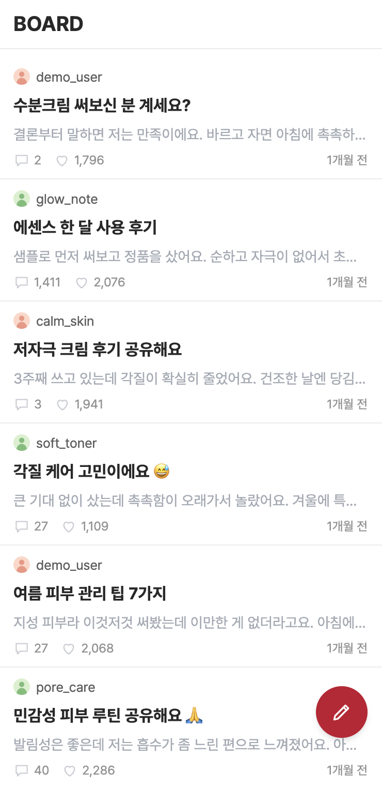
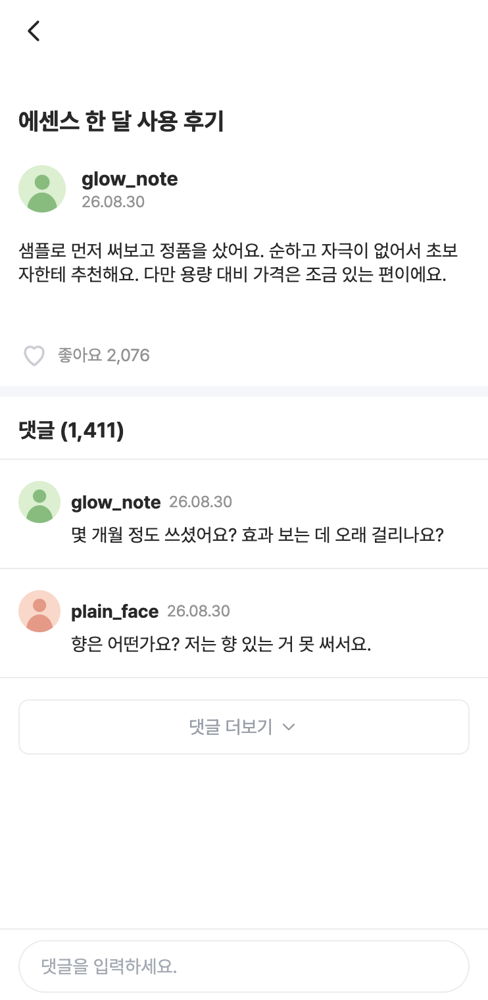
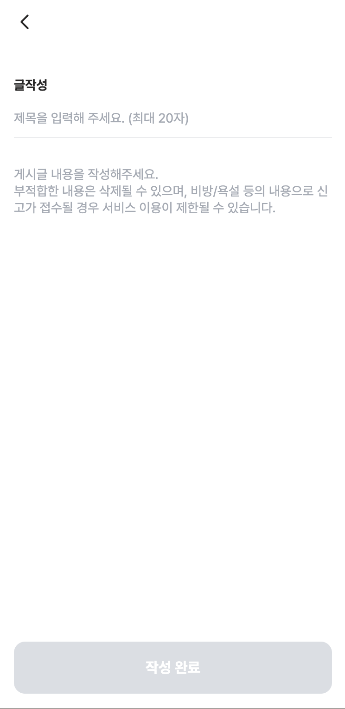
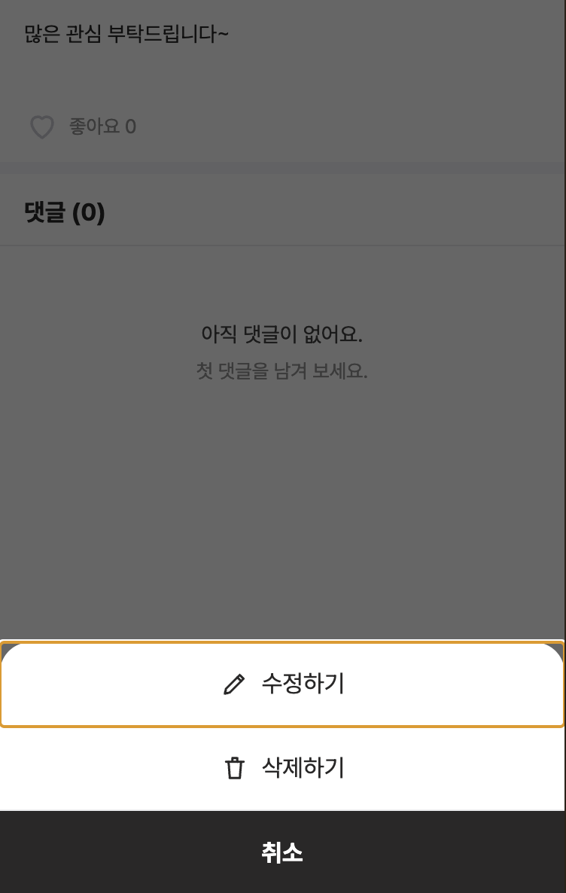

# BOARD

모바일 웹(375px) 커뮤니티 앱 BOARD입니다. 목록 · 상세 · 작성/수정 · 좋아요 · 댓글을 프론트엔드(Next.js)와 백엔드(Spring Boot)로 직접 설계·구현했습니다.
개발 과정에서 AI 에이전트(Claude)를 어떻게 활용했는지는 [AI 에이전트 활용](#ai-에이전트-활용)과 [`docs/development-log.md`](./docs/development-log.md)에 정리했습니다. 이 저장소의 데이터(시드)는 가상의 값입니다.

<p align="center">
  
  
  
  
</p>

이 README는 **무엇을 골랐는지보다 왜 골랐고 무엇을 포기했는지**를 중심으로 썼습니다. 근거가 되는 코드는 파일·함수로 표시했습니다.

| 절 | 내용 |
| --- | --- |
| [실행](#실행) | 실행 방법, 실행·로컬 개발에 필요한 것, 테스트 실행 |
| [기술 선택](#기술-선택) | 라이브러리·도구와 고른 이유, 포기한 것 |
| [API 설계](#api-설계) | 요구사항이 맡긴 부분: 페이지네이션, 상태 코드, 검증 |
| [상태 설계](#상태-설계) | 서버 데이터를 어디에 두고 어떻게 맞추는지 |
| [구조](#구조) | 프론트엔드·백엔드 계층을 나눈 기준 |
| [데이터 적재](#데이터-적재) | 스키마와 `seed.json` 적재 방식 |
| [정합성과 동시성](#정합성과-동시성) | 동시 요청에서 깨질 수 있는 지점과 막은 방법 |
| [테스트](#테스트) | 무엇을 왜 테스트했는지 |
| [부하 테스트](#부하-테스트) | k6 측정 결과 |
| [개선한 점 · 남은 과제](#개선한-점--남은-과제) | 임의로 정한 것, 알려진 한계 |
| [AI 에이전트 활용](#ai-에이전트-활용) | 에이전트와 어떻게 일했고, 무엇을 직접 판단·검증했는지 |

---

## 실행

```bash
docker compose up
```

| | 주소 |
| --- | --- |
| 프론트엔드 | http://localhost:3000 |
| 백엔드 | http://localhost:8080 |
| 기동 확인 | http://localhost:8080/health · `GET /health` 는 유지해주세요 |

포트가 이미 사용 중이면 환경 변수로 바꿀 수 있습니다.

```bash
FRONTEND_PORT=13000 BACKEND_PORT=18080 DB_PORT=25432 docker compose up --build
```

`BACKEND_PORT`를 바꾸면 프론트엔드를 다시 빌드해야 해서 `--build`가 필요합니다.
`NEXT_PUBLIC_API_BASE_URL`이 빌드 시점에 클라이언트 번들로 인라인되기 때문입니다.

<details>
<summary>참고 — 제공된 스타터의 구성</summary>

```
seed/seed.json        초기 데이터
docker-compose.yml    DB(PostgreSQL 16) + 백엔드 + 프론트엔드
backend/              Spring Boot 3.5 / Java 17. DB 연결 · GET /health · CORS 설정만 있습니다.
frontend/             Next.js 15 App Router. 기본 설정과 app/dev-user/ 만 있습니다.
```

- **DB 호스트 포트 기본값은 `15432`** 입니다. `5432`는 이미 쓰고 있는 경우가 많아 피했습니다.
- `seed/`는 백엔드 컨테이너의 `/seed`에 읽기 전용으로 마운트됩니다. (`APP_SEED_PATH`)
- DB 데이터는 named volume(`dbdata`)에 남습니다. `docker compose down`을 해도 유지되고,
  **초기화하려면 `docker compose down -v`** 를 쓰세요.
- 브라우저에서 호출할 때와 컨테이너 안에서 호출할 때 주소가 달라, API 주소를 두 개 줍니다.
  - `NEXT_PUBLIC_API_BASE_URL` — 브라우저에서 (클라이언트 컴포넌트)
  - `API_BASE_URL` — 컨테이너 안에서 (서버 컴포넌트 · 라우트 핸들러)
- **`/dev-user`** 에서 요청자를 바꿀 수 있습니다. 고르면 `x-user-id` 쿠키가 설정됩니다.
  쿠키가 없으면 기본 요청자는 `demo_user`입니다.
- 백엔드 의존성에는 `spring-boot-starter-jdbc`만 들어 있습니다. ORM은 직접 고르세요.
- 테스트 환경(`spring-boot-starter-test` · JUnit · Mockito)은 준비되어 있습니다.
  테스트를 작성하면 그대로 동작합니다.
- 폰트는 `frontend/public/fonts/`의 **Pretendard**를 쓰면 됩니다. `globals.css`에 적용되어 있습니다.
- **CORS는 설정되어 있습니다** (`CorsConfig.java`). `http://localhost:*`(및 `127.0.0.1:*`) 오리진을
  자격 증명과 함께 허용하므로 포트를 바꿔도 동작합니다. 브라우저에서 직접 호출할 때는 요청에
  `credentials: "include"`를 붙여야 `x-user-id` 쿠키가 전송됩니다.

로컬 개발은 compose 없이 하셔도 됩니다. DB만 띄우고 각각 실행하는 쪽이 빠릅니다.

```bash
docker compose up db
cd backend  && ./gradlew bootRun
cd frontend && npm install && npm run dev
```

</details>

### 실행에 필요한 것 (실행 환경)

- **Docker**(Docker Desktop, 또는 Docker Engine + Compose v2)만 있으면 됩니다. JDK·Node 는 필요 없습니다. 백엔드·프론트엔드 모두 이미지 안에서 빌드합니다.
- 첫 실행은 Gradle·npm 의존성을 내려받고 빌드하느라 몇 분 걸릴 수 있습니다.
- 기본 포트 `3000`(프론트) · `8080`(백엔드) · `15432`(DB)가 사용 중이면 위의 환경 변수로 바꿉니다. `BACKEND_PORT`를 바꿀 때는 `--build`가 필요합니다.
- 백엔드는 **시드 적재가 끝난 뒤에** 요청을 받기 시작합니다. 그래서 `GET /health`가 200이면 데이터도 준비된 상태이고, 프론트엔드는 백엔드가 healthy 가 된 뒤에 뜹니다([데이터 적재](#데이터-적재)).
- 데이터를 처음 상태로 되돌리려면 `docker compose down -v` 후 다시 실행합니다.
- 확인한 환경: macOS(Apple Silicon), Docker 29.6.2, Docker Compose v5.3.1. 포트를 바꾼 실행(`FRONTEND_PORT=13000 BACKEND_PORT=18080 DB_PORT=25432 docker compose up --build`)에서 DB·백엔드·프론트엔드가 모두 healthy 상태가 되는 것을 확인했습니다.

### 로컬 개발·테스트 (선택)

실행만 한다면 필요 없고, 코드를 직접 실행하거나 테스트를 돌릴 때만 필요합니다.

| 대상 | 필요한 것 |
| --- | --- |
| 프론트엔드 | Node **22.22.2 이상의 22.x** 또는 24.15 이상(Vitest 5·jsdom 30 의 요구 버전, CI·Docker 이미지도 Node 22). Node 20·23 은 지원 범위 밖이라 `npm test`가 실패할 수 있습니다. |
| 백엔드 | Java 17, 그리고 테스트용으로 **실행 중인 Docker**(Testcontainers 가 PostgreSQL 16 컨테이너를 띄웁니다). |

```bash
cd backend  && ./gradlew test
cd frontend && npm ci && npm run typecheck && npm test
```

**Docker Engine 29 이상에서 백엔드 테스트가 Docker 접속 오류(400)로 실패하는 경우**: Engine 29 부터 Docker API 최소 버전이 1.44 로 올라갔는데, Spring Boot 3.5.0 이 관리하는 Testcontainers 1.21.0 은 더 낮은 버전으로 접속합니다. 아래 설정을 한 번 추가하면 동작합니다.

```bash
echo "api.version=1.44" >> ~/.docker-java.properties
```

---

## 기술 선택

고정된 네 가지(Java 17 + Spring Boot 3, Next.js 15 + TypeScript, PostgreSQL, `docker compose`) 외의 선택입니다.
이유는 일반적인 장점이 아니라 **이 프로젝트의 조건**(작은 데이터, 요구사항의 삭제 정책, 동시 요청, 모바일 화면)에서 출발했습니다.

### 백엔드

| 영역 | 선택 | 이유 | 포기한 것 |
| --- | --- | --- | --- |
| 전체 구조 | **모듈러 모놀리스**(한 앱 안에서 `post`·`comment`·`like` 패키지) | 엔드포인트 9개·글 39개 규모라 독립 확장할 이유가 없습니다. 목록의 `commentCount`, "삭제된 글의 댓글은 안 보임" 같은 규칙이 서비스 경계를 넘으면 서비스 간 호출이나 카운트 복제(이벤트 유실·중복)가 생기는데, 한 DB에서는 서브쿼리와 트랜잭션 하나로 정확하게 끝납니다. 요구사항도 단일 백엔드와 `docker compose up` 한 번을 전제합니다. | 서비스별 독립 배포·확장·장애 격리. 분리할 때 바꿀 지점은 [구조](#구조)에 적었습니다. |
| 데이터 접근 | **JPA(쓰기) + JPQL DTO 프로젝션(읽기) + JdbcTemplate(좋아요·시드)** | 목록은 `commentCount`·`isLiked`가 필요한데, 엔티티를 읽어 연관관계로 채우면 N+1 이 되고 컬렉션 fetch join + 페이징은 메모리 페이징이 됩니다. 그래서 연관관계 없이 서브쿼리를 포함한 프로젝션 한 번으로 읽습니다(`PostRepository.SELECT_VIEW`). 좋아요 수를 엔티티로 읽고 +1 하면 동시 요청에서 갱신이 유실되므로 원자적 SQL 을 직접 씁니다(`PostLikeRepository`). | 두 방식이 섞여 일관성이 떨어집니다. 대신 "쓰기는 엔티티, 목록은 프로젝션, 원자 갱신·대량 적재는 JDBC"로 쓰임새를 나눴습니다. JDBC 경로에는 `@SQLRestriction`(삭제 제외)이 적용되지 않아 `deleted_at is null`을 직접 써야 합니다. |
| 스키마 관리 | **Flyway + `ddl-auto=validate`** | 삭제되지 않은 행만 색인하는 부분 인덱스(`WHERE deleted_at IS NULL`)는 JPA 애노테이션으로 선언할 수 없습니다. 스키마의 기준을 SQL(`V1__init.sql`) 한 곳에 두고, Hibernate 는 기동할 때 엔티티와 어긋나는지만 검사합니다. | 스키마를 바꿀 때마다 마이그레이션 파일을 추가해야 합니다. |
| 페이지네이션 | **keyset(커서)** | [API 설계](#api-설계) 참고. | 임의 페이지로 건너뛸 수 없습니다(무한 스크롤에는 필요 없음). |
| 테스트 DB | **Testcontainers PostgreSQL 16**(H2 미사용) | 부분 인덱스, `ON CONFLICT`, `RETURNING`, advisory lock, 행 락 모드처럼 이 프로젝트의 핵심 동작이 PostgreSQL 전용이라 H2 로는 증명할 수 없습니다. | 테스트에 Docker 가 필요하고 느립니다. |
| 빌드 | 스타터의 **Gradle** 유지 | 바꿀 이유가 없고, 스타터와 맞추는 편이 이득입니다. | — |

### 프론트엔드

| 영역 | 선택 | 이유 | 포기한 것 |
| --- | --- | --- | --- |
| 데이터 호출 | **클라이언트 컴포넌트에서 `fetch(..., { credentials: "include" })`** (`shared/api/client.ts`) | 모든 화면이 무한 스크롤·낙관적 업데이트처럼 클라이언트 캐시 중심입니다. 서버 컴포넌트에서 미리 불러오면 `HydrationBoundary`로 서버 결과를 클라이언트 캐시에 이어야 하고 목록·상세 캐시를 따로 맞춰야 해서 복잡도가 늘어납니다. 로그인 후의 모바일 커뮤니티라 SEO 요구도 없습니다. 쿠키는 포트를 구분하지 않아 `/dev-user`가 `localhost:3000`에 설정한 `x-user-id`가 `localhost:8080`에도 전송됩니다. | 첫 화면이 로딩 상태(스켈레톤)로 시작합니다. 목록 첫 페이지만 서버에서 미리 불러오는 방식은 검토 후 보류했습니다. |
| 서버 상태 | **TanStack Query** | 같은 글이 목록 캐시와 상세 캐시에 동시에 있고, 좋아요·댓글 수가 바뀌면 둘을 함께 고치고 실패하면 함께 되돌려야 합니다. 이 동기화(낙관적 반영, 롤백, 무효화)와 커서 기반 무한 스크롤(`useInfiniteQuery`)을 라이브러리에 맡겼습니다. SWR 은 롤백과 여러 캐시 동기화를 직접 처리할 부분이 더 많습니다. | 의존성이 하나 늘고, 쿼리 키를 잘못 설계하면 목록과 상세가 어긋날 책임을 직접 집니다. 그래서 키를 한 파일(`features/posts/keys.ts`)에서만 만듭니다. |
| UI 전역 상태 | **Zustand, 토스트 하나만** (`shared/store/toast.ts`) | 화면 이동을 넘어 유지되는 UI 상태는 "작성 완료 → 목록 이동 후 토스트" 하나뿐입니다. 토스트는 mutation 콜백처럼 컴포넌트 밖에서 호출되는데, Zustand 는 Provider 없이 `useToast.getState().show()`로 부를 수 있고 구독한 컴포넌트만 다시 그립니다. 쿼리 파라미터(`?toast=created`)는 새로고침·뒤로가기에서 토스트가 다시 뜹니다. | 상태 하나를 위해 의존성을 추가했습니다. 루트 layout 의 Context 로도 만들 수 있었습니다. |
| 스타일링 | **Tailwind CSS v4** (`app/globals.css`의 `@theme`) | 피그마에서 측정한 색·반경을 `@theme` 토큰으로 등록하면 그 값이 곧 유틸리티 클래스가 되어 토큰 밖의 값을 쓰기 어렵습니다. 런타임이 없는 CSS 라 App Router 와 충돌이 없습니다(styled-components·emotion 은 별도 레지스트리 설정이 필요). | 클래스 문자열이 길어집니다. 반복되는 UI 는 컴포넌트(`shared/ui`)로 뽑았습니다. |
| 팝업·바텀시트 | **Radix UI Dialog** (`shared/ui/ConfirmDialog.tsx`, `BottomSheet.tsx`) | 포커스 가두기·ESC·`aria`·스크롤 잠금은 직접 만들면 틀리기 쉽습니다. Radix 는 동작만 주고 모양이 없어서 시안과 픽셀을 맞출 수 있습니다. shadcn CLI 는 쓰지 않고 필요한 것만 작성했습니다. | 바텀시트를 스와이프로 닫을 수 없습니다(`vaul`이 제공하지만 시안에 요구가 없어 제외). |
| 폼 검증 | **직접 구현** (react-hook-form·zod 미사용, `features/posts/PostForm.tsx`) | 필드가 둘이고 비동기 검증이 없습니다. 제목 20자를 서버와 같은 **코드포인트** 기준으로 세고, 붙여넣기는 잘라내고, 한글 조합(IME) 중에는 자르지 않아야 해서 어차피 입력값을 직접 제어해야 합니다. 이 상황에서 비제어 방식인 react-hook-form 이 줄여 주는 것이 없습니다. | 폼이 커지면 재사용성이 떨어집니다. |
| 무한 스크롤 감지 | **IntersectionObserver 직접 사용** (`shared/ui/InfiniteSentinel.tsx`) | 필요한 것은 목록 끝 요소 하나의 진입 감지뿐이라 작은 컴포넌트로 충분합니다. 스크롤 이벤트 계산은 레이아웃 계산 비용이 큽니다. | 정리(disconnect)·재관찰 같은 경계를 직접 챙깁니다. |
| 시간 표기 | **`Intl` + 순수 함수** (`shared/lib/time.ts`) | 필요한 것이 상대 시간과 `yy.MM.dd` 두 가지, 시간대도 `Asia/Seoul` 하나라 날짜 라이브러리가 필요 없습니다. 실수하기 쉬운 경계(59/60초, 23/24시간, 6/7일, 29/30일, 364/365일)를 순수 함수로 분리해 테스트했습니다. | 다국어·복잡한 형식으로 넓힐 때 직접 고쳐야 합니다. |
| 테스트 | **Vitest + React Testing Library** | TypeScript·ESM 설정이 단순하고 빠릅니다(Jest 는 Next.js 의 SWC·ESM 설정이 더 필요). | 브라우저 E2E 는 작성하지 않았습니다([테스트](#테스트)). |

---

## API 설계

요구사항이 형태를 정해 둔 부분(`items`·`total`, 단일 객체, `{ isLiked, likeCount }`)은 필드를 더하거나 빼지 않았습니다.
요구사항이 맡긴 부분만 아래처럼 정했습니다.

### 목록을 나눠 불러오는 방법: keyset 커서

```
GET /api/posts?limit=20                      → { items, total, nextCursor }
GET /api/posts?limit=20&cursor={nextCursor}  → 다음 페이지, 마지막이면 nextCursor: null
GET /api/posts/{id}/comments?limit=2         → 상세 첫 화면(댓글 2개)
GET /api/posts/{id}/comments?limit=20&cursor=…  → "더보기" 이후
```

- 정렬은 `(created_at DESC, id DESC)`이고, 커서는 마지막 항목의 `(createdAt, id)`를 `base64url("{epochSecond}_{id}")`로 감싼 **불투명 문자열**입니다(`common/Cursor`). 클라이언트는 해석하지 않고 그대로 돌려줍니다.
- `limit + 1`건을 읽어 다음 페이지가 있는지 판단합니다(`common/PageResponse.of`). `total`은 삭제를 뺀 전체 개수입니다.
- `limit`은 기본 20, 최대 50(넘으면 50으로 보정), 1 미만이면 400 입니다(자율 결정).
- **offset 대신 keyset 을 고른 이유**
  - 시드는 id 순서와 작성 시각 순서가 다르고 같은 초에 작성된 데이터가 많습니다. 시각과 id 를 함께 써야 동률에서도 중복·누락이 없습니다.
  - offset 은 앞 페이지에서 글이 추가·삭제되면 다음 페이지에 중복·누락이 생깁니다. 무한 스크롤 중에 다른 사람이 글을 쓰는 상황이 흔한 커뮤니티에서는 치명적입니다.
  - 정렬 키와 같은 부분 인덱스(`idx_posts_feed`, `idx_comments_by_post`)가 삭제 제외와 정렬을 함께 처리해, 1,411개 댓글을 끝까지 넘겨도 깊이와 상관없이 같은 비용입니다.
- 시각은 **초 단위로 잘라 저장**합니다. 응답 형식(`2026-08-30T13:55:54Z`)과 DB 값이 같아야 커서가 왕복해도 어긋나지 않기 때문입니다.

### 상태 코드와 오류

| 상황 | 상태 | `code` |
| --- | --- | --- |
| 작성(글·댓글) | 201 | — |
| 삭제(글·댓글) | 204 | — |
| 조회·수정·좋아요 토글 | 200 | — |
| 검증 실패, 해석할 수 없는 본문·파라미터 | 400 | `VALIDATION_ERROR` |
| 해석할 수 없는 커서 | 400 | `INVALID_CURSOR` |
| 남의 글·댓글 수정·삭제 | 403 | `FORBIDDEN` |
| 없거나 **삭제된** 글·댓글, 삭제된 글의 댓글 조회·작성·삭제, 삭제된 글의 좋아요 | 404 | `NOT_FOUND` |

- 오류 본문은 `{ "code", "message" }`입니다(`common/ApiExceptionHandler`).
- 판정 순서는 **404 → 403 → 400** 으로 고정했습니다. 삭제된 글을 남이 수정하려 하면 403 이 아니라 404 라서, 삭제된 리소스의 존재 여부를 드러내지 않습니다.

### 검증 규칙

- 제목: 1~20자, **코드포인트** 기준(이모지 하나 = 1자). UTF-16 길이(`String.length()`)로 세면 이모지가 2자가 되어 사용자가 보는 글자 수와 어긋납니다. 서버(`Post.validate`)와 화면(`shared/lib/codepoint.ts`)이 같은 기준입니다.
- 공백만 있는 제목·내용·댓글은 거부합니다. 저장하는 값은 **다듬지 않고 받은 그대로**입니다(서버가 조용히 값을 바꾸지 않음).
- 길이 상한(자율 결정, 방어용): 글 내용 20,000자, 댓글 5,000자.
- 요청자는 `x-user-id` 헤더 → 쿠키(URL 디코딩) → `demo_user` 순서로 정하고, 50자를 넘으면 400 입니다(`common/RequesterResolver`). 컨트롤러는 `Requester` 파라미터로 받기만 합니다.

---

## 상태 설계

### 원칙: 서버 데이터는 쿼리 캐시 한 곳에만 둔다

서버에서 받은 데이터는 **TanStack Query 캐시에만** 두고, 컴포넌트 state 나 Zustand 로 복사하지 않습니다.
복사본이 생기면 어느 쪽이 최신인지 맞추는 일이 생기기 때문입니다.

| 쿼리 키 | 내용 | 정의 |
| --- | --- | --- |
| `['posts', 'list']` | 글 목록(무한, 커서 페이지들) | `features/posts/keys.ts` `postKeys.list()` |
| `['posts', 'detail', id]` | 글 상세 | `postKeys.detail(id)` |
| `['comments', postId]` | 댓글 목록(무한) | `features/comments/keys.ts` `commentKeys.list()` |

- 댓글 키를 `['posts', …]` 밖에 둔 이유: 좋아요가 진행 중인 글 조회를 `['posts']` 단위로 취소·무효화하는데, 그때 댓글 페이지까지 흔들리지 않게 하려는 분리입니다.
- 기본 옵션(`app/providers.tsx`): `staleTime` 30초, 창 포커스 시 재조회 안 함, 4xx 는 다시 시도해도 같으므로 재시도하지 않고 네트워크 오류·5xx 만 한 번 더 시도합니다.

### 같은 글이 두 캐시에 있는 문제

좋아요 수·댓글 수는 목록 카드와 상세에 동시에 보입니다. 둘이 갈라지면 상세에서 누른 좋아요가 뒤로 가기 후 목록에 반영되지 않습니다.
그래서 글을 고치는 모든 경로가 **`updatePostInCaches`(`features/posts/cache.ts`) 한 함수**로 두 캐시를 함께 고칩니다.

| 동작 | 캐시 처리 | 위치 |
| --- | --- | --- |
| 목록 → 상세 진입 | 목록 캐시의 같은 글을 `placeholderData`로 먼저 보여 주고 서버 값으로 바꿉니다. 그동안 좋아요 버튼은 막습니다. | `features/posts/queries.ts` `usePost` |
| 좋아요 | 누르는 즉시 바꾸고(낙관적), 응답의 `{ isLiked, likeCount }`로 두 캐시를 **덮어씁니다**. 클라이언트가 ±1 을 이어 계산하지 않아 다른 사용자의 좋아요가 섞여도 어긋나지 않습니다. 같은 글의 요청은 `scope`로 한 번에 하나씩 보내고, 연타 중에는 마지막 응답만 화면에 반영합니다(앞선 응답마다 하트가 깜빡이지 않게). 실패하면 요청 직전 스냅샷이 아니라 **마지막으로 서버가 확정한 값 + 아직 남은 토글**로 되돌립니다. 스냅샷으로 되돌리면 연타 중 앞서 성공한 클릭까지 취소되기 때문입니다. | `features/posts/mutations.ts` `useToggleLike` |
| 글 작성 | 목록 캐시를 `resetQueries`로 비우고 `router.replace('/')`. 여러 페이지가 쌓인 목록에 끼워 넣는 대신 처음부터 다시 받아, 새 글이 맨 위에 오는 것을 서버 기준으로 보장합니다. `replace`라서 뒤로 가기로 작성 폼에 돌아가 같은 글을 또 올리지 않습니다. | `useCreatePost`, `PostWrite.tsx` |
| 글 수정 | 서버가 돌려준 글 전체로 두 캐시를 교체합니다. | `useUpdatePost` |
| 글 삭제 | 목록 캐시를 비우고, 상세 캐시는 지우지 않고 오래된 것으로만 표시합니다(지우면 화면이 남아 있는 동안 다시 불러와 "없는 글" 화면이 잠깐 보입니다). 404 는 이미 원하는 결과이므로 성공으로 봅니다. | `useDeletePost` |
| 댓글 작성·삭제 | 응답에 글의 댓글 수가 없으므로 두 캐시의 `commentCount`를 ±1 하고, 댓글 목록은 다시 받습니다. 다시 받지 않으면 첫 페이지(2개)에서 하나를 지웠을 때 뒤에 댓글이 남아 있는데도 "더보기"가 사라집니다. 재조회가 끝날 때까지 mutation 을 대기 상태로 두어 중복 제출을 막습니다. | `features/comments/mutations.ts` |

### 저장하지 않고 계산하는 상태

- **댓글 "더보기"를 눌렀는가**: 컴포넌트 state 로 두었다가 버그를 만났습니다. 뒤로·앞으로 이동으로 상세를 다시 열면 캐시에는 여러 페이지가 남아 있는데 state 만 초기화되어, 이미 길게 보이는 목록에 "더보기"가 다시 나타나고 스크롤 로딩이 꺼졌습니다. 지금은 `data.pages.length > 1 || isFetchingNextPage || isFetchNextPageError`로 **캐시에서 계산**합니다(`CommentSection.tsx`). 정보의 출처가 하나라서 어긋날 수 없습니다.
- **본인 글·댓글인가**: 응답에 "내 것" 표시가 없으므로 `author`를 쿠키의 요청자와 비교합니다(`shared/lib/currentUser.ts`, 서버와 같은 디코딩 규칙).

### 수정 폼의 초기값

상세 캐시는 목록에서 온 placeholder 로 먼저 채워질 수 있습니다. 폼 초기값을 그대로 연결하면 오래된 값이 보이고, 뒤늦게 도착한 서버 값이 **입력 중인 내용을 덮어씁니다**.
그래서 placeholder 가 아닌 서버 응답이 도착한 뒤에만 폼을 그리고, 폼은 `key={post.id}`로 한 번 만들어 초기값을 마운트 때만 넣습니다(`PostEdit.tsx`, `PostForm.tsx`).

### UI 상태

- 팝업·바텀시트 열림, 입력값은 컴포넌트 로컬 `useState`.
- 화면 이동을 넘는 상태는 토스트 하나뿐이라 Zustand 스토어 하나만 둡니다. 토스트를 그리는 `Toaster`는 화면을 이동해도 다시 마운트되지 않는 `(app)/layout.tsx`에 있습니다.

---

## 구조

### 백엔드: 기능별 패키지 + 엔티티가 자기 규칙을 가짐

```
io.github.parkseyoung128.board
├── post/      PostController · PostService · PostRepository · Post(엔티티) · PostRequest/PostResponse
├── comment/   CommentController · CommentService · CommentRepository · Comment
├── like/      LikeController · LikeService · PostLikeRepository(JDBC) · PostLike(읽기 전용 매핑)
├── seed/      SeedLoader · SeedData
└── common/    RequesterResolver · Cursor · PageResponse · ApiException · ApiExceptionHandler
```

- **나눈 기준**: 계층(controller/service/repository)이 아니라 **기능**으로 먼저 나눴습니다. 바뀔 때 함께 바뀌는 코드가 한 폴더에 있어야 읽기 쉽고, 나중에 기능 단위로 떼어내기도 쉽습니다. 기능 안에서는 Controller → Service → Repository 순서로만 호출합니다.
- **계층의 책임**
  - Controller: HTTP 만 다룹니다. 요청자는 `Requester` 파라미터로 주입받습니다.
  - Service: 트랜잭션, 판정 순서(404 → 403 → 400), 락을 담당합니다.
  - 엔티티: 자기 규칙을 가집니다. `Post.create/edit/validate/assertOwner/softDelete`처럼 검증과 상태 변경이 엔티티 메서드에 있어서, 어느 서비스에서 고쳐도 같은 규칙이 지켜집니다.
- **엔티티 사이에 JPA 연관관계를 두지 않았습니다.** `Comment`는 `postId` 값만 가집니다. 연관관계가 있으면 N+1 과 컬렉션 fetch join 페이징 문제가 생기고, 모듈끼리 객체로 엮입니다.
- **경계를 넘는 곳(알고 둔 것)**
  - `CommentService`와 `LikeService`가 글이 살아 있는지 확인하고 락을 잡으려고 `PostRepository`를 직접 씁니다.
  - 목록 조회(`PostRepository.SELECT_VIEW`)가 `comments`·`post_likes`를 서브쿼리로 읽습니다.
  - 지금 규모에서는 한 트랜잭션·한 쿼리로 정확한 값을 얻는 쪽이 이득이라 이렇게 두었습니다. 서비스를 나눈다면 이 두 곳이 바뀝니다. 글 존재 확인은 `post` 모듈의 공개 인터페이스(분리 후에는 HTTP 클라이언트)로, `commentCount`는 비정규화 컬럼 + 댓글 작성·삭제 이벤트로 바뀝니다.

### 프론트엔드: 라우팅 · 기능 · 공용

```
app/                     라우팅만. 주소의 id 를 검사하고 기능 컴포넌트를 고른다(서버 컴포넌트)
  (app)/layout.tsx       375px 셸 + Toaster
  (app)/page.tsx         목록           → features/posts/PostList
  (app)/write/           작성           → features/posts/PostWrite
  (app)/posts/[id]/      상세           → features/posts/PostDetail
  (app)/posts/[id]/edit/ 수정           → features/posts/PostEdit
  dev-user/              (제공, 수정하지 않음. (app) 셸 밖)
features/
  posts/     api.ts → keys.ts · queries.ts · mutations.ts · cache.ts → 화면 컴포넌트
  comments/  같은 구성
shared/
  api/       apiFetch(credentials, 오류 → ApiError)
  lib/       time · codepoint · number · avatar · currentUser (순수 함수)
  store/     toast (Zustand)
  ui/        Header · BackButton · Icon · Avatar · InfiniteSentinel · BottomSheet · ConfirmDialog · Toaster
```

- **나눈 기준**: `app/`은 주소와 화면을 연결만 하고, 도메인 로직은 `features/`에, 도메인을 모르는 것은 `shared/`에 둡니다. `shared`는 `features`를 import 하지 않습니다.
- **기능 안의 흐름**: `api.ts`(HTTP 호출) → `queries.ts`·`mutations.ts`(캐시 규칙) → 컴포넌트(표시). 컴포넌트는 `fetch`를 직접 부르지 않고, 캐시를 고치는 규칙은 `mutations.ts`·`cache.ts`에만 있습니다.
- `page.tsx`는 서버 컴포넌트로 두고, 상호작용이 있는 부분만 클라이언트 컴포넌트(`"use client"`)입니다.
- 상태 판단은 모든 화면이 같은 원칙을 따릅니다.
  - 데이터가 없을 때의 오류만 전체 오류 화면으로 보여 줍니다.
  - 다음 페이지 오류는 목록을 유지하고 하단에 "다시 시도"를 둡니다.
  - 재조회 실패는 보이는 내용을 그대로 둡니다. `isError`만 보면 멀쩡한 목록이 오류 화면으로 바뀌기 때문입니다.

---

## 데이터 적재

### 스키마 (`backend/src/main/resources/db/migration/V1__init.sql`)

| 테이블 | 핵심 | 이유 |
| --- | --- | --- |
| `posts` | `id GENERATED BY DEFAULT AS IDENTITY`, `like_count INTEGER CHECK (>= 0)`, `deleted_at TIMESTAMPTZ` | 시드의 id 를 그대로 넣어야 해서 `BY DEFAULT`(id 를 직접 지정할 수 있음)입니다. 좋아요 수는 목록마다 세지 않도록 비정규화하고, 갱신은 원자적 SQL 로만 합니다. |
| `comments` | `post_id` FK, `deleted_at` | 댓글 수는 저장하지 않고 조회할 때 셉니다(아래). |
| `post_likes` | `PRIMARY KEY (post_id, user_id)` | "한 사람은 한 글에 한 번만"을 DB 가 보장합니다. 동시 요청에서도 중복 행이 생길 수 없습니다. |

- 부분 인덱스 `idx_posts_feed (created_at DESC, id DESC)`와 `idx_comments_by_post (post_id, created_at DESC, id DESC)`는 모두 `WHERE deleted_at IS NULL` 입니다. 조회는 항상 삭제되지 않은 행만 보므로 삭제된 행은 색인에서 뺍니다.
- 삭제 표시는 boolean 이 아니라 `deleted_at`입니다. 삭제 시각이 남고, `IS NULL` 조건이 부분 인덱스와 잘 맞습니다.
- **좋아요 수는 비정규화했는데 댓글 수는 왜 세는가**
  - 좋아요는 **셀 수가 없습니다.** 시드는 `likeCount`만 주고 누가 눌렀는지 기록은 주지 않으므로, 숫자를 컬럼에 저장하고 이후 증감만 원자적으로 반영해야 합니다. 목록마다 세는 비용이 없어지는 것은 덤입니다.
  - 댓글 수는 "삭제된 댓글 제외" 규칙이 있어, 저장하면 작성·삭제·시드 적재 모든 경로에서 카운터를 맞춰야 합니다. 지금 규모(가장 많은 글이 1,411개)에서는 부분 인덱스로 세는 비용이 작아서(목록 p95 약 4ms, [부하 테스트](#부하-테스트)) 정확성을 택했습니다.
  - 대가: 댓글이 매우 많아지면 목록을 볼 때마다 세는 비용이 커집니다. 그때는 `comment_count` 비정규화로 바꿀 계획입니다.
- `total`도 요청마다 `count`합니다. 같은 이유로 지금 규모에서는 정확성을 택했습니다.

### `seed.json` 적재 (`backend/.../seed/SeedLoader.java`)

| 요구 | 방법 |
| --- | --- |
| 기동하면 바로 조회 가능 | `SmartInitializingSingleton`으로 **웹 서버가 요청을 받기 전에** 적재합니다. `ApplicationRunner`는 서버가 뜬 뒤 실행되어 `/health`가 200 인데 데이터가 아직 없는 순간이 생깁니다. 지금은 `/health` 200 이 곧 적재 완료이고, compose 가 이 헬스체크를 기다려 프론트를 띄웁니다. |
| id 유지 | 시드의 id 를 그대로 넣고, 적재 후 `setval`로 시퀀스를 `max(id)`에 맞춰 새 글·댓글 id 가 겹치지 않게 합니다. |
| 재기동해도 중복 없음 | `INSERT ... ON CONFLICT (id) DO NOTHING`. 이미 있는 행은 건너뜁니다. 그래서 앱에서 삭제한 시드 글이 재기동 후 되살아나지 않고, 그동안 쌓인 좋아요 수도 시드 값으로 돌아가지 않습니다. |
| 삭제된 항목 | `deletedPostIds`·`deletedCommentIds`는 행을 넣으면서 `deleted_at`을 채웁니다. 행은 있지만 어떤 조회에도 나오지 않습니다. |
| `commentCount` | 저장하지 않습니다. 조회할 때 삭제되지 않은 댓글만 셉니다. |
| `isLiked` | 좋아요 기록(`post_likes`)이 비어 있으므로 모두 `false`이고, `like_count`만 시드 값에서 시작합니다. |
| 동시 기동 | 한 트랜잭션 안에서 advisory lock 을 잡습니다. 인스턴스가 동시에 떠도 한 번만 적재됩니다. |
| 시각 | 초 단위로 잘라 저장합니다(커서와 같은 규칙). |

- 대량 삽입이라 JPA `saveAll` 대신 JDBC 배치(500건 단위)를 씁니다.
- 시드 파일이 없거나 읽을 수 없으면 **기동을 실패**시킵니다. 데이터 없이 뜬 서버는 정상이 아니기 때문입니다. `app.seed-enabled=false`로 끌 수 있습니다(통합 테스트에서 사용).
- 결과: 게시글 42개 중 39개, 댓글 2,076개 중 1,926개가 보입니다(가장 많은 글은 1,411개). `SeedLoaderTest`가 이 숫자와 멱등성을 확인합니다.
- 대가: 시드 파일을 고쳐도 이미 들어간 행은 갱신되지 않습니다(의도한 멱등 동작). 시드가 아주 커지면 기동이 느려집니다.

---

## 정합성과 동시성

여러 요청이 같은 행을 동시에 건드릴 때 깨질 수 있는 지점을 찾고, **재현 테스트를 먼저 만든 뒤** 고쳤습니다.
경합 테스트는 sleep 같은 타이밍에 기대지 않습니다. 한쪽 트랜잭션이 락을 쥔 채 커밋 전인 상태를 직접 만들고, 다른 요청이 락 대기에 들어간 것을 `pg_stat_activity`로 확인한 뒤 커밋해서 결과를 봅니다(`LockProbe`).

| 상황 | 막지 않으면 생기는 일 | 해결 | 검증 |
| --- | --- | --- | --- |
| 여러 사용자가 같은 글에 동시에 좋아요 | 읽고 +1 하면 갱신이 유실됨 | `INSERT ... ON CONFLICT DO NOTHING`으로 기록을 넣고, 넣었으면 `UPDATE ... SET like_count = like_count + 1 RETURNING`, 이미 있으면 지우고 −1 (`LikeService.toggle`) | `LikeApiTest`: 수십 명 동시, 카운트 = 기록 수 |
| 한 사용자가 연타 | 유일 제약만으로는 "삽입 → 삭제" 사이에 요청이 끼어들어 클릭이 반영되지 않는 경우가 있었음(CI 에서 간헐적으로 실패해 발견) | (글, 사용자) 단위 `pg_advisory_xact_lock`으로 같은 사람의 요청만 한 줄로 세웁니다. 다른 사용자끼리는 기다리지 않습니다. | 홀수·짝수 번 연타, 여러 사용자 동시 연타, 음수 방지 |
| 글 수정·삭제 중 좋아요 | Hibernate 는 모든 컬럼을 UPDATE 하므로, 수정이 읽어 둔 옛 `like_count`로 덮어씀 | `like_count`에 `updatable = false`. 카운트는 원자적 SQL 로만 바꿉니다. | `PostLikeCountIntegrityTest` |
| 글 삭제 중 댓글 작성 | 삭제는 soft delete(UPDATE)라 FK 가 막아 주지 않음. "글 확인 → INSERT" 사이에 삭제가 커밋되면 삭제된 글에 댓글이 생기고 201 이 나감 | 댓글 작성은 글 행을 `FOR KEY SHARE`, 삭제는 `FOR UPDATE`로 잡아 서로를 기다리게 합니다. 삭제가 먼저면 댓글 작성은 조건을 다시 평가해 404 가 됩니다. | `PostDeleteRaceTest` |
| 글 삭제 중 좋아요 | 삭제된 글에 기록이 남음 | 별도 락 없이 안전합니다. `UPDATE ... WHERE id = ? AND deleted_at IS NULL`이 삭제의 행 락을 기다린 뒤 조건을 다시 평가해 0건 → 404 → 롤백됩니다. | `PostDeleteRaceTest` |
| 글 삭제 중 수정 | 수정의 UPDATE 가 `deleted_at = null`까지 덮어써 **삭제된 글이 되살아남** | 수정도 먼저 글 행을 `FOR NO KEY UPDATE`로 잡습니다. 삭제가 먼저 커밋되면 404 입니다. | `PostDeleteRaceTest` |
| 무한 스크롤 중 글 추가·삭제 | offset 이면 다음 페이지에 중복·누락 | keyset 커서 | `PaginationTest`: 같은 초 동률, 순회 중 삭제 |
| 백엔드 여러 개가 동시에 기동 | 시드 중복 적재 | advisory lock + `ON CONFLICT` | `SeedLoaderTest` |

**락 모드를 고른 이유**

- 댓글 작성에 `FOR SHARE`가 아니라 `FOR KEY SHARE`를 썼습니다. `FOR SHARE`는 좋아요의 `like_count` UPDATE 와 충돌해 인기 글에서 댓글 작성이 좋아요를 기다리게 됩니다. `FOR KEY SHARE`는 이 UPDATE 와 충돌하지 않습니다.
- 대신 삭제가 락 없이 UPDATE 만 하면 `KEY SHARE`와 충돌하지 않으므로, 삭제는 반드시 `FOR UPDATE`를 먼저 잡습니다(`PostRepository.lockLiveForUpdate`).
- 수정은 `FOR NO KEY UPDATE`라 진행 중인 댓글 작성을 막지 않습니다(테스트로 확인).

**대가**: JPA 밖의 SQL 과 락 모드를 직접 관리해야 합니다. 같은 사용자가 여러 연결로 연타하면 그 요청들이 advisory lock 을 기다리는 동안 DB 커넥션을 하나씩 잡고 있습니다. 인기 글 하나에 좋아요가 몰리면 `like_count` 한 행에 대한 락 경합이 남습니다(측정값은 아래).

---

## 테스트

| 영역 | 도구 | 규모 | 실행 |
| --- | --- | --- | --- |
| 백엔드 통합 | JUnit 5 · Spring Boot Test · MockMvc · **Testcontainers(PostgreSQL 16)** | 테스트 84개 | `./gradlew test` |
| 프론트 단위·컴포넌트 | Vitest · React Testing Library(jsdom, fetch 를 가짜로 대체) | 테스트 128개 | `npm test` |
| CI | GitHub Actions(`.github/workflows/ci.yml`) | PR·main push 마다 백엔드 테스트, 프론트 타입체크·테스트·빌드 | — |

### 무엇을 왜 테스트했는가

요구사항이 "응답으로 확인한다"고 한 규칙(남의 글을 지울 수 없는지, 삭제된 글이 보이지 않는지)과, **틀리기 쉬운데 눈으로는 확인하기 어려운 것**을 우선했습니다.

**백엔드**: 실제 HTTP 요청(MockMvc) → 실제 PostgreSQL 로 검증합니다.

| 묶음 | 확인하는 것 | 클래스 |
| --- | --- | --- |
| API 계약 | 요구사항의 필드만 내려가는지, `isLiked`가 요청자 기준인지, 상태 코드와 판정 순서(404 → 403 → 400) | `PostApiTest`, `CommentApiTest`, `LikeApiTest` |
| 삭제 정책 | 삭제된 글·댓글이 목록·상세·`commentCount`·댓글·좋아요 어디에도 나오지 않는지 | 위 클래스들 |
| 페이지네이션 | 같은 초 동률, id 와 시간 순서가 다른 경우, 1,411개 끝까지 무중복·무누락, 순회 중 삭제, 이상한 커서·limit | `PaginationTest`, `CommentPaginationTest`, `CursorTest`, `PageResponseTest` |
| 검증 | 제목 20/21자 경계, 이모지 1자, 공백만, 입력값을 다듬지 않음 | `PostValidationTest`, `CommentValidationTest` |
| 요청자 | 헤더 우선, 쿠키 URL 디코딩, 공백, 50자(코드포인트) | `RequesterResolverTest` |
| 동시성·경합 | [정합성과 동시성](#정합성과-동시성)의 표 전체 | `LikeApiTest`, `PostLikeCountIntegrityTest`, `PostDeleteRaceTest` |
| N+1 | 목록 쿼리 수가 글 수와 상관없이 일정한지 | `QueryCountTest` |
| 시드 | 개수, id·내용 유지, 재적재 멱등, 삭제·좋아요 수가 되돌아가지 않는지, 시퀀스, 동시 적재 | `SeedLoaderTest` |

**프론트엔드**

| 묶음 | 확인하는 것 | 파일 |
| --- | --- | --- |
| 순수 함수 | 상대 시간 경계값, `Asia/Seoul` 날짜 넘어감, 코드포인트 세기·자르기, 쿠키 읽기 | `shared/lib/*.test.ts` |
| 목록 | 스켈레톤 → 카드, 빈 목록, 첫 페이지 오류와 다시 시도, 다음 페이지 오류에서 감시 중단, 재조회 실패에도 목록 유지 | `PostList.test.tsx`, `PostCard.test.tsx` |
| 상세·좋아요 | 본인 글에만 ⋯ 메뉴, 낙관적 반영과 두 캐시 동기화, 연타 순서, 실패 시 확정값 복구, 다른 곳에서 삭제(404) | `PostDetail.test.tsx` |
| 댓글 | 2개 → 더보기(3개 이상일 때만) → 스크롤, 뒤로·앞으로 이동 후 더보기 재노출 없음, 본인 댓글만 삭제, 한글 조합 중 Enter | `CommentSection.test.tsx` |
| 작성·수정 | 버튼 활성 조건, 20자·이모지, IME 조합 중 자르지 않음, 중복 제출 방지, 수정 초기값 덮어쓰기 방지, 403·404 처리 | `PostForm.test.tsx`, `PostFlow.test.tsx` |

**작성 방식**: 버그를 고칠 때는 재현 테스트를 먼저 쓰고, 고치기 전 코드에서 실패하는 것을 확인했습니다.

**하지 않은 것**: 실제 브라우저로 프론트와 서버를 함께 띄우는 E2E(Playwright 등)는 작성하지 않았습니다. 화면 흐름은 컴포넌트 테스트에서 API 응답을 가짜로 대체해 검증했고, 실제 연동은 `docker compose up` 후 직접 확인했습니다. 그래서 프론트와 백엔드 사이의 계약이 바뀌는 회귀는 자동으로 잡지 못합니다.

---

## 부하 테스트

설계 결정의 근거를 수치로 확인하려고 k6 스크립트를 작성했습니다(`loadtest/`, 실행 방법은 [`loadtest/README.md`](./loadtest/README.md)). 요구사항의 요구사항은 아닙니다.

- 환경: Apple M5(10코어) · 메모리 24GB 노트북 한 대에서 k6 와 서버·DB 를 **함께** 실행했습니다(Docker Desktop CPU 10 · 메모리 약 7.75GiB). 서버 설정은 기본값(Hikari 풀 10, Tomcat 스레드 200)입니다. 절대 성능이 아니라 "이 환경에서의 값"입니다.
- 각 시나리오를 3회 실행했고, 표의 값은 중앙값(괄호는 범위)입니다. 쓰기는 테스트가 만든 전용 글에만 해서 시드 데이터는 바뀌지 않습니다.

| 시나리오 | 부하 | 처리량 | p95 | 오류 |
| --- | --- | --- | --- | --- |
| 목록 순회 + 상세 | 50명, 요청 사이 0.5~1.5초 대기 | 117 req/s | 목록 4.3ms · 상세 1.9ms | 0% |
| 댓글 1,411개 글 | 처음 2개 → 더보기 40명 + 끝까지 순회 8명 | 295 req/s | 처음 4.5ms · 더보기 3.2ms · 끝까지 순회 3.7ms | 0% |
| 혼합(읽기 55 · 댓글 읽기 20 · 좋아요 15 · 댓글 작성 10%) | 100명 | 286 req/s | 1.3~3.9ms | 0% |
| 좋아요: 같은 글, 서로 다른 사용자 | 100명, 대기 없이 30초 | 약 1,800건/s (1,700~2,500) | 89ms (68~98) | 0% |
| 좋아요: 같은 글, 100명이 각자 켜기·끄기 연타 | 사용자당 약 200회 | 약 2,700건/s | 57ms (56~59) | 0% |
| 좋아요: 한 사용자 연타 | 연결 10개, 20초 | 약 3,700건/s | 3.0ms | 0% |

**정합성(가장 중요한 결과)**: 3회 모두 최종 좋아요 수가 기대값과 정확히 같았습니다.

- 서로 다른 사용자 500명이 연결 200개로 한꺼번에 → 500.
- 30초 연속 → 성공한 요청 수와 같음(51,362 / 76,266 / 54,829).
- 한 사용자 연타 → 성공 횟수의 홀짝과 같음(72,158번 → 0, 75,127번 → 1, 73,934번 → 0).
- 100명이 각자 켜기·끄기를 섞어 회차당 20,050번 → 기대값 50.
- 음수가 된 응답은 없었습니다.

**해석**

- 읽기는 댓글 1,411개 글을 끝까지 넘겨도 깊이와 상관없이 지연이 일정했습니다(keyset + 부분 인덱스).
- 좋아요는 같은 글 한 행에 갱신이 몰리면 처리량이 약 2,000~3,000건/s 에서 멈추고 지연이 늘어납니다. 예상되는 병목 지점(인기 글의 `like_count` 행)과 일치합니다.
- **확인하지 못한 것**
  - 이 지연이 커넥션 풀(10개) 대기 때문인지, 행 락 대기 때문인지는 이 데이터로 구분하지 못했습니다.
  - 읽기 시나리오는 요청 사이에 대기가 있어 서버의 한계점을 찾은 것은 아닙니다.

---

## 개선한 점 · 남은 과제

### 시안에 없거나 흐름이 명확하지 않아 정한 것

| 항목 | 정한 내용 | 이유 |
| --- | --- | --- |
| 로딩·빈 목록·오류 화면 | 목록·상세·댓글에 스켈레톤, "아직 게시글이 없어요" 같은 안내, "다시 시도" 버튼 | 시안에 없지만 네트워크가 느리거나 실패할 때 빈 화면이 되지 않게 |
| 다음 페이지 실패 | 목록은 유지하고 하단에 "다시 시도", 실패 중에는 자동 재요청 중단 | 실패한 요청을 무한히 반복하지 않게 |
| 목록 끝 | "마지막 글입니다" 표시 | 무한 스크롤이 끝났다는 것을 알 수 있게 |
| 없는·삭제된 글 | 안내 문구 + 목록으로 가는 버튼. 보고 있던 글이 다른 곳에서 삭제되어도 이 화면으로 바뀜 | 삭제된 본문과 좋아요 버튼이 남아 있지 않게 |
| 댓글 시각 | 30일 미만은 상대 시간, 이후는 `yy.MM.dd`. 목록은 항상 상대 시간, 상세 본문은 `yy.MM.dd`(시안) | 요구사항은 목록만 정해서, 오래된 댓글은 날짜가 더 읽기 쉽다고 판단 |
| 수정 화면 | 작성과 같은 폼이고 문구만 "글수정" / "수정 완료", 저장 후 "게시글이 수정되었습니다." 토스트 | 지금 무엇을 하는지 구분되게. 토스트는 요구사항 외 추가 |
| 수정 후 이동 | 상세의 "수정하기"로 들어왔으면 뒤로 이동, 그 밖에는 상세로 `replace` | 기록에 상세가 두 번 쌓이지 않게. 출처는 주소(`?from=detail`)로 명시 |
| 제목 입력 | Enter 를 누르면 제출하지 않고 내용 칸으로 이동. 한글 조합 확정 Enter 는 무시 | 모바일 키보드의 이동 키로 실수 제출하지 않게 |
| 댓글 입력 | 한 줄 입력(시안의 pill 형태). 내용이 있을 때만 전송 아이콘. 앞뒤 공백을 뺀 값을 보냄 | 한 줄 입력이라 앞뒤 공백에 의미가 없음. 서버는 받은 값을 그대로 저장 |
| 아바타 | 작성자명으로 3종 중 하나를 고정 선택 | 같은 사람은 항상 같은 아바타 |
| 데스크톱에서 열 때 | 화면을 375px 셸 안에 두고, 글쓰기 버튼·토스트·댓글 입력창도 셸 기준으로 배치 | 넓은 화면에서 버튼이 화면 끝에 붙지 않게 |
| 길이 상한 | 글 내용 20,000자, 댓글 5,000자, `limit` 최대 50 | 방어용 값(요구사항 없음) |

### 알려진 한계

- **뒤로가기 버튼**: `history.length > 1`이면 브라우저 기록으로 돌아갑니다. 이 값은 세션 전체 기록이라, 외부 사이트에서 상세 주소로 바로 들어오면 앱 밖으로 나갈 수 있습니다. 수정 후 이동에서는 같은 이유로 이 방식을 쓰지 않았습니다.
- **글 삭제 후 이동**: `replace('/')`라서 기록이 "목록 → 목록"이 되어, 목록에서 뒤로 가기를 한 번 누르면 변화가 없어 보입니다.
- **스크롤 위치 복원**: 상세에서 뒤로 오면 캐시가 남아 있는 동안(기본 5분)은 목록이 바로 그려져 위치가 유지되지만, 캐시가 사라진 뒤에는 맨 위에서 시작합니다.
- **결합 이모지**: 👨‍👩‍👧 처럼 화면에서는 1자인 이모지를 여러 자로 셉니다. 서버와 같은 기준(코드포인트)을 우선했습니다.
- **규모가 커질 때**: 목록마다 `commentCount`·`total`을 세는 비용이 댓글 수에 비례합니다. 다음 단계는 `comment_count` 비정규화와 `total` 캐시입니다. 인기 글 좋아요의 행 락 경합은 카운터를 여러 행으로 나누거나 비동기로 집계하는 방식을 검토할 지점입니다.
- **서비스 분리**: 필요해지면 바꿀 곳은 [구조](#구조)에 적은 두 지점(글 존재 확인, `commentCount`)입니다.

### 시간이 더 있었다면

- **작성·수정 중 나갈 때 확인 창**: 지금은 입력하던 중에 뒤로 가면 확인 없이 나가고 입력이 사라집니다. 입력한 내용이 있을 때만 "작성 중인 내용이 사라집니다. 나가시겠어요?"를 묻고, 없으면 바로 나가게 하고 싶었습니다.
- **브라우저 E2E 테스트**: `docker compose`로 띄운 실제 서버 위에서 작성 → 목록 토스트, 좋아요, 댓글 2개 → 더보기 → 스크롤, 본인 글 수정·삭제를 사용자를 바꿔 가며 확인하는 테스트(Playwright). 지금은 프론트와 백엔드 사이 계약이 바뀌는 회귀를 자동으로 잡지 못합니다([테스트](#테스트)).

### 진행 방식

- 기능마다 이슈 → 브랜치 → PR → `main` 병합으로 진행했습니다(`.github/ISSUE_TEMPLATE`, `PULL_REQUEST_TEMPLATE.md`).
- PR 마다 CI(백엔드 테스트, 프론트 타입체크·테스트·빌드)와 CodeRabbit 자동 리뷰를 거쳤습니다. 리뷰 기준은 `.coderabbit.yaml`에 영역별로 적어 두었습니다.

---

## AI 에이전트 활용

이 프로젝트는 AI 코딩 에이전트(Claude)와 함께 개발했습니다. 에이전트에게 맡긴 것과 제가 직접 정하고 검증한 것을 구분해 적습니다. 작업 규칙은 [`AGENTS.md`](./AGENTS.md), 실제 사례는 [`docs/development-log.md`](./docs/development-log.md)에 있습니다.

| 구분 | 내용 |
| --- | --- |
| 제가 정한 것 | 요구사항 해석, 아키텍처와 기술 선택, 에이전트 제안의 채택·기각, 모든 git 작업(커밋·브랜치·PR), 최종 실행·테스트 |
| 에이전트와 함께 한 것 | 설계 대안 비교, 코드 리뷰와 경합 조건 분석, 재현 테스트 작성, 수정 구현, 문서와 코드의 불일치 점검, 리뷰(CodeRabbit) 지적의 타당성 검토 |

일하는 방식은 세 가지를 지켰습니다.

- **변경 전 요약, 승인 후 수정**: 에이전트가 무엇을 왜 바꾸는지 요약해 주고 제가 승인한 뒤에만 코드를 고치게 했습니다.
- **재현 테스트 먼저**: 경합 같은 버그는 실패하는 테스트로 먼저 재현하고, `sleep`이 아니라 락 대기 상태를 직접 만들어 결정적으로 검증했습니다.
- **주장은 코드로 검증**: 에이전트·외부 리뷰·다른 AI의 지적을 그대로 받지 않고 코드에서 확인한 뒤 반영했습니다. 에이전트 환경에서는 Gradle과 Docker를 실행할 수 없었기 때문에 백엔드 테스트는 제가 직접 실행해 확인했습니다.

에이전트 활용을 말로만 두지 않고 네 가지 도구로 나누어 저장소에 넣었습니다.

| 도구 | 위치 | 하는 일 |
| --- | --- | --- |
| `CLAUDE.md` / `AGENTS.md` | 루트 | 불변식, 구조·테스트 규칙, 작업 절차. 각 규칙은 실제로 겪은 문제에서 나왔습니다. |
| 서브에이전트 | `.claude/agents/` | 읽기 전용으로 동시성 경합을 체크리스트로 점검 |
| Skill | `.claude/skills/race-check/` | 쓰기 경로를 바꿀 때의 절차: 탐지 → 판정 → 재현 테스트 → 수정 |
| Hooks | `.claude/hooks/` | git 변경·PR 생성 차단, 기존 마이그레이션 수정 차단. 규칙을 말이 아니라 장치로 강제 |

**실험**: 사람이 하나씩 찾아 고친 동시성 결함 4건을, 수정 전 코드에 서브에이전트를 돌려 사전에 찾을 수 있는지 측정했습니다. 일반 지시는 4건 중 3건, 체크리스트를 준 에이전트는 4건을 찾았고 오탐은 없었습니다. 그러나 두 경우 모두 실제로 CI를 깨뜨린 연타 경합의 심각도를 잘못 판단했습니다(일반 지시는 "안전", 체크리스트는 "낮음"). 각 1회 실행이고 체크리스트는 결함을 겪은 뒤에 설계했다는 한계와 함께 [`experiments/race-hunt`](./experiments/race-hunt/README.md)에 원문과 재현 방법을 올려 두었습니다.

이 저장소는 원본 프로젝트에서 이름과 데이터를 바꿔 정리한 것이라 커밋 이력은 새로 시작했습니다. 당시 이슈·PR의 흐름은 개발 로그에 옮겼습니다.
